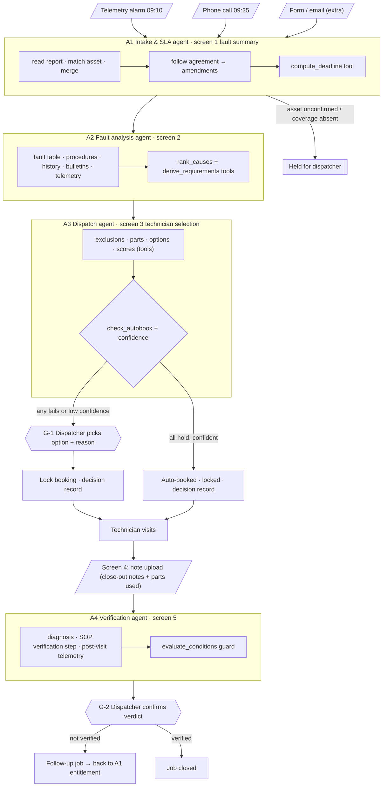

# FirstFix — Solution architecture (v0.2, agentic)

2026-11-24 · UC8 · spec of record. Supersedes v0.1 (2026-11-23).

**What changed:** OQ-1 is decided. FirstFix follows the agent flow Shubham walked through at the
AiroCatalog standup on 24 Nov 2026. **Shubham's flow is the main design.** Anything in this document
that his flow does not state is an architectural decision of ours and is marked **[to confirm]**.
Where the BRD (v1.0, 17 Nov) adds detail his flow doesn't cover, we follow the BRD.

## 1. Shubham's flow (source of truth)

From the 24 Nov standup notes:

1. A fault is reported by customer call, email, portal or an automatic equipment alert. IoT telemetry can register faults by itself.
2. **The agent** identifies the asset, consolidates duplicate reports into one ticket, and calculates the deadline from the first reported time using the SLA.
3. **The agent** evaluates technician skills, scores, certifications and required items, and makes the assignment. **Human in the loop** if confidence is low or no technician can meet the deadline.
4. The system is backend only, for dispatchers. It is not customer-facing.
5. The technician visits, does the work and **uploads notes to the portal**. **The agent** compares the notes against the SOPs and the IoT sensor data.
6. If AI verification says the issue isn't fully resolved even though the tasks are closed, a **follow-up job** is created (decision aligned in the meeting).
7. Five screens: **fault summary, fault analysis, technician selection, note upload, AI verification**.

## 2. Decisions at a glance

| Decision | Choice | Basis | Status |
|---|---|---|---|
| Agents | **4 agents, one per stage and screen of Shubham's flow:** A1 Intake & SLA, A2 Fault analysis, A3 Dispatch, A4 Verification. Each is a tool-calling loop that decides what to fetch and loops until it can submit. | Flow steps 2, 3, 5 and the five screens. His notes say "the agent"; we read that as one agent per stage. | **[to confirm]** one agent per stage vs one agent overall |
| Numbers | SLA deadline, cause likelihoods, option scores, slack and verification conditions come from **deterministic tools** the agents call. A model never writes a number that appears on screen. | BRD NFR-001, NFR-005; house rule | **[to confirm]** OQ-3, OQ-6 |
| Orchestration | One LangGraph parent graph. Fixed edges A1 → A2 → A3, ending at the dispatcher gate. A4 runs on close-out. Each agent is a subgraph: ReAct loop, step limit 12, ends by calling a `submit_*` tool with a typed schema. | Flow order; BRD governing principle (coverage → diagnosis → parts → filter → score) | Flow order: Shubham. Graph shape: **[to confirm]** |
| Human in the loop | A3 escalates when (a) its confidence is low, (b) no technician meets the deadline (both Shubham), or (c) any BRD auto-book condition fails (BR-011). A3 may escalate more often than the rule requires but can never auto-book when the rule says escalate: `book_auto` re-checks server-side. | Flow step 3; BRD FR-033/034 | (a)(b) Shubham; (c) and the guard **[to confirm]** |
| Gate mode | Post-run. A run ends at the decision point, and the decision API resumes the next segment. No checkpointer. | v0.1 OQ-2 | **[to confirm]** OQ-2 |
| Retrieval | Tools open named documents by pointer (asset → agreement register, model + fault family → fault table → procedure). No vector search. | Fixed authored mock pack | **[to confirm]**: RAG over manuals was asked of Shubham and is pending |
| Verification | A4 judges with the SOP verification step plus telemetry. A guard tool (`evaluate_conditions`) stops A4 returning "verified" when a condition failed, and forces "insufficient evidence" on a telemetry gap (BR-015). Follow-up is proposed and created only on dispatcher confirmation. | Flow steps 5–6; BRD FR-047..051 | Follow-up: Shubham. Guard: **[to confirm]** OQ-4 |
| Replay | Each agent's full trajectory (tool calls, tool outputs, final submit) is pinned by agent + input hash + prompt version. The demo replays it with model access off. | BRD NFR-002, NFR-010 | House rule |
| Stack | React + Vite + Tailwind · FastAPI (Python 3.12) · LangGraph · Azure OpenAI · PostgreSQL · pytest + ruff · Azure Container Apps / Static Web Apps. Ports: backend 8008, frontend 3008, Postgres 5438 (local). Repo layout mirrors uc7-verity. | v0.1, Verity conventions | Unchanged |

## 3. Flow



## 4. Agents

| | A1 Intake & SLA | A2 Fault analysis | A3 Dispatch | A4 Verification |
|---|---|---|---|---|
| Shubham's step | 2: identify asset, merge duplicates, deadline from SLA | Screen 2 "fault analysis"; "required items" in step 3 | 3: evaluate skills, scores, certs, items; assign; HITL | 5–6: compare notes to SOP and IoT; follow-up |
| Screen | 1 Fault summary | 2 Fault analysis | 3 Technician selection | 5 AI verification |
| Read tools | `get_report`, `match_asset`, `find_open_tickets`, `list_agreement_documents`, `open_document` | `get_fault_table`, `get_procedure`, `get_service_history`, `get_bulletins` (filtered to model and part by code), `get_telemetry_breaches` | `list_technicians`, `get_requirements`, `get_stock` | `get_closeout`, `get_diagnosis`, `get_verification_step`, `get_telemetry_window` |
| Calculate tools | `map_alarm_code`, `apply_merge_rule` (BR-002), `compute_deadline` (BR-001, SV-04) | `rank_causes` (SV-07: likelihood, separability, contention, safety), `derive_requirements` (SV-02) | `check_exclusions`, `check_parts` (SV-03), `build_and_score_options` (SV-05 + SV-04 slack), `check_autobook` (SV-06) | `evaluate_conditions` (SV-08: BR-015 + gap rule) |
| Write tools | `submit_ticket` | `submit_diagnosis` | `book_auto` (server re-checks), `submit_escalation` | `submit_verdict`, `propose_followup` (status proposed) |
| Output | Ticket (asset, merged reports, fault family, clock start); entitlement (governing document, coverage, SLA, citations); deadline | Causes with evidence status + citations; likelihoods (from tool); not-separable flag; likely parts; requirement set; safety flag | Option table with 4 score components; exclusions with rule; recommendation, confidence, rationale; auto-booked or escalated with reason codes; trade-off summary (figures filled by code) | Verdict (verified / not verified / insufficient evidence) with cited telemetry windows and note text; proposed follow-up |
| HITL triggers | Asset unconfirmed; coverage unconfirmed or absent | (none: flags carried to A3) | Low confidence; no technician meets deadline; any BR-011 condition fails; safety flag | Always: dispatcher confirms (FR-051) |
| Replaces from v0.1 | LLM-01, SV-01, AG-02 model call, SV-04 | AG-01 model call, SV-07, SV-02 | SV-03, SV-05, SV-06 (as tools), LLM-02 | AG-03 model call, SV-08, SV-06 follow-up |

**Technician brief** (BRD S4, LLM-03) stays a single model call after the booking locks, with figures
filled by code. Shubham's five screens have no brief screen, so it becomes a panel on screen 3
**[to confirm]**. Uncommitted (extra-1).

**Note upload** (screen 4) is a dispatcher-side upload of close-out notes and parts used. The BRD
excludes a technician mobile app (8.2); this is a plain upload form, not an app **[to confirm]**.

### Why agents now pass the bar

Each agent decides what to fetch next from what it has already read: A1 opens the agreement, sees it
references schedules and amendments, opens each, and checks effective dates. A2 follows the alarm's
fault family into the fault table, then each cause's procedure, then checks history and bulletins for
the parts named. A4 reads the original diagnosis to know which verification step applies. The
retrieval trap (CU-2 moved from schedule A, 8 h, to schedule B, 4 h, by amendment 2) is what A1 must
get right.

## 5. Guards ("shall never")

| Rule | Guard | Test |
|---|---|---|
| Auto-book only when every BR-011 condition holds | `book_auto` re-runs `check_autobook` server-side; refuses otherwise | Agent forced to call `book_auto` on main scenario → refused |
| Never book an excluded technician (FR-039) | Decision API and `book_auto` recheck exclusions | AC-08 |
| No number on screen from a model (NFR-005) | Agents submit numbers only by tool-output reference; prose uses placeholders filled by code; validator rejects literal figures not in tool outputs | Planted-figure test |
| Entitlement from the latest amendment in effect (BR-003) | Validator: governing doc must be latest in-effect document mentioning the asset | AC-02 + decoy amendment 3 |
| A4 cannot contradict the conditions (BR-015) | `submit_verdict` rejected if "verified" with any failed condition, or not "insufficient evidence" on a gap | Unit tests |
| No job closed / reopened / created without confirmation (FR-051) | Follow-up stays `proposed` until G-2 | AC-11 |
| Locked bookings never move (FR-041) | Bookings read through a read-only repository | T4 row hash test |
| Decision record immutable after lock (NFR-008) | DB trigger + 409 | AC-07 |
| Agent loops forever / fails | Step limit 12; on limit or error the step shows as failed with manual entry offered (NFR-007) | Forced-failure test |
| Model never sees the answer | Answer key lives in `data/mock-data/05_answer_key/`, never loaded; neutral file names; leak test over every tool output | W-019 |

## 6. Gates

| Gate | When | Checker | Reason required |
|---|---|---|---|
| G-1 Escalated booking | A3 escalates | Dispatcher | Every booking (FR-038); breach flagged (BR-013) |
| G-2 Close-out verdict | A4 submits | Dispatcher | Rejecting the verdict or declining the follow-up |
| G-3 Chargeable work | A1 finds no agreement (VS-02) | Dispatcher | Yes (extra-4) |
| G-4 Asset unconfirmed | A1 can't match one asset | Dispatcher | Stored status only (deferred) |

## 7. Scoring (OQ-6) **[to confirm]**

Each option gets four components on a 0–1 scale, rounded to 2 dp. The total is the weighted sum of
the rounded components, rounded to 2 dp, so a dispatcher can check it by hand.

| Component | Formula |
|---|---|
| Travel | 1 − drive minutes / 240, floor 0 |
| SLA slack | 0 if breach, else min(1, slack minutes / 240) |
| Parts fit | full 1.0 · partial 0.5 · none 0 |
| Skill margin | 0.5 at the required level, 1.0 at one level or more above |
| Total | 0.25 × each (equal weights, BRD open item 2) |

AUTO_BOOK_SCORE 0.75 is read on this scale. Main scenario: T1 direct 0.71 (highest, but partial fit,
so it can never auto-book), T1 via depot 2 0.60, T4 after locked job 0.57.

## 8. Data model and API (changes from v0.1)

Unchanged from v0.1 except:
- `model_outputs` is replaced by `agent_trajectories` (run_id, agent, step, tool, args, output, output_hash, prompt_version, approved_by, pinned).
- `runs.retrieval_log` is assembled from tool calls (NFR-003).
- New endpoint `POST /api/jobs/{id}/closeout` for note upload (screen 4).
- `GET /api/tickets/{id}/options` also returns A3's recommendation, confidence and rationale.

## 9. Mock data contract

```
data/mock-data/01_reports/     raw reports per channel
data/mock-data/02_documents/   agreements, manual extracts, bulletins, history notes (.md, page markers)
data/mock-data/03_structured/  reference tables, roster, stock, telemetry (tools read these)
data/mock-data/04_config/      parameters.yaml: every BRD parameter + ours
data/mock-data/05_answer_key/  expected figures + the facts each document must state; never loaded
data/mock-data/validate.py     recomputes every answer-key figure from data + parameters
```

`05_answer_key/agreement_facts.csv` is the contract for whoever writes the agreement documents:
each schedule and amendment must say exactly what that file says.

## 10. Scope and hours

| Change from v0.1 | Hours |
|---|---|
| Named-document tool layer (W-901) | +3 |
| A1 replaces LLM-01 + AG-02 model call | +3 |
| A2 replaces AG-01 model call | +3 |
| A3 agent around SV-03/05/06 tools | +3 |
| Trade-off summary moves into A3 (from extra-1) | +3.5 core |
| Trajectory pinning and replay (W-905) | +2 |
| A4 replaces AG-03 model call (extra-2) | +3 |
| Note upload screen (extra-2) | +2 |

- **Core: ~115.5 h of 140 (82.5%).** Over the 70% line we set in v0.1.
- **Core + phase 2 (extra-2, 26.5 h): ~142 h (101%).** About 2 h over a 4-dev, 5-day week.
- Brief (LLM-03 + panel) becomes uncommitted.

**[to confirm]** with Shubham: accept the overrun, or plan phase 2 into week 2.

The WBS (`doc-internal/wbs.csv`, v0.2) carries these changes: W-016/W-017 → A1, W-018 → A2,
W-039 tool layer, W-040 A3 (absorbs W-101), W-021 trajectory replay, W-203 → A4, W-211 note upload.

## 11. Open decisions

- [ ] One agent per stage vs one agent overall — Shubham
- [ ] RAG over manuals vs pointer tools — Shubham (asked)
- [ ] OQ-2 gate mode (post-run vs interrupt)
- [ ] OQ-3 likelihoods from a tool vs the agent
- [ ] OQ-4 verdict guard
- [ ] OQ-5 depot detour basis (default: drive detour ≤ 90 min + 45 min handling)
- [ ] OQ-6 score formula and weights (section 7)
- [ ] OQ-7 SLA calendar (default: elapsed 24x7, site-local)
- [ ] A3 confidence threshold for HITL (default: escalate unless "high")
- [ ] Brief as a panel on screen 3; note upload as a plain form
- [ ] Hours: overrun vs week 2
- [ ] OQ-8..OQ-19: defaults in the appendix

## Appendix: smaller open questions (defaults in use)

| ID | Question | Default |
|---|---|---|
| OQ-8 | How a free-text report gets a fault family (for merging) | A1 classifies into the closed list from `alarm_map.csv`, citing the phrase; anything outside the list is rejected |
| OQ-9 | Demo date and run time | 2026-12-01; dispatch run at 09:30 after both reports; T2's certificate expired 3 days before |
| OQ-10 | DEFAULT_SLA is circular in the BRD | Shorter candidate when 2+ candidates; 4 h fallback otherwise |
| OQ-11 | BRD open-items list missing | This list stands in |
| OQ-12 | Second sign-off on SLA breach | None in v1 (dispatcher is the only approver) |
| OQ-13 | May the variants be split so VS-01/VS-07 land first | Kept whole, uncommitted |
| OQ-14 | "Causes in contention" | Top cause + every cause within CAUSE_MARGIN of it |
| OQ-15 | Verification window start | Close-out submission (14:05) |
| OQ-16 | Same depot part counted by two jobs | Accept and disclose; one job at a time |
| OQ-17 | Who changes parameters | Developers via config |
| OQ-18 | Certificate basis | Skill matrix rows include diagnosis-step needs (gauge connection) |
| OQ-19 | VS-02 slack with no SLA | Slack component n/a, weights renormalised, never auto-books |
